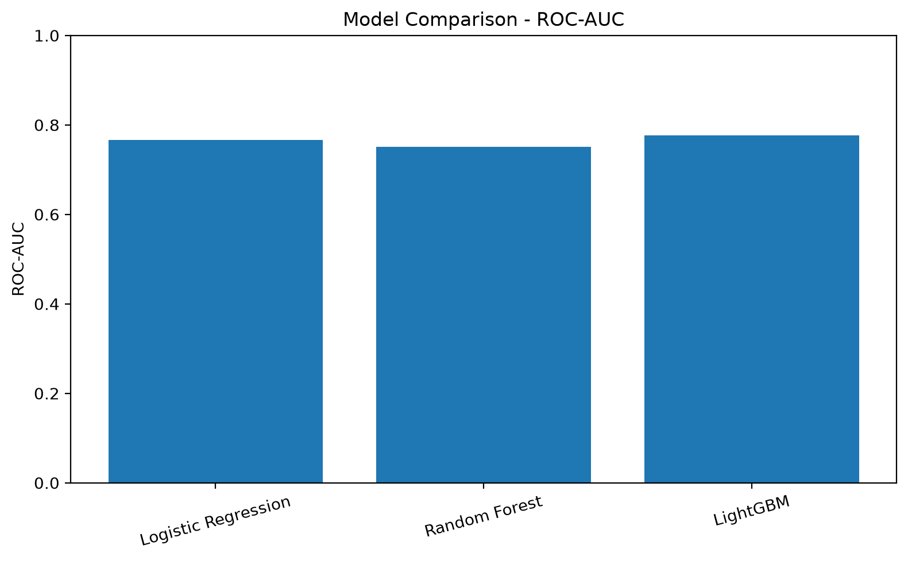
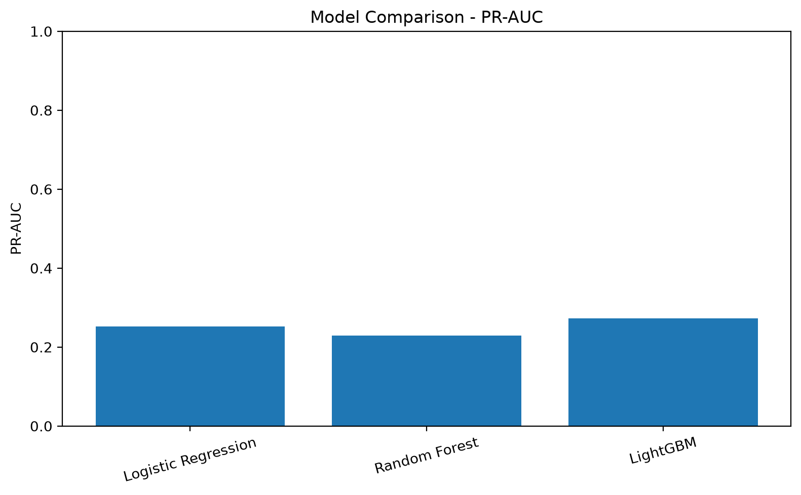
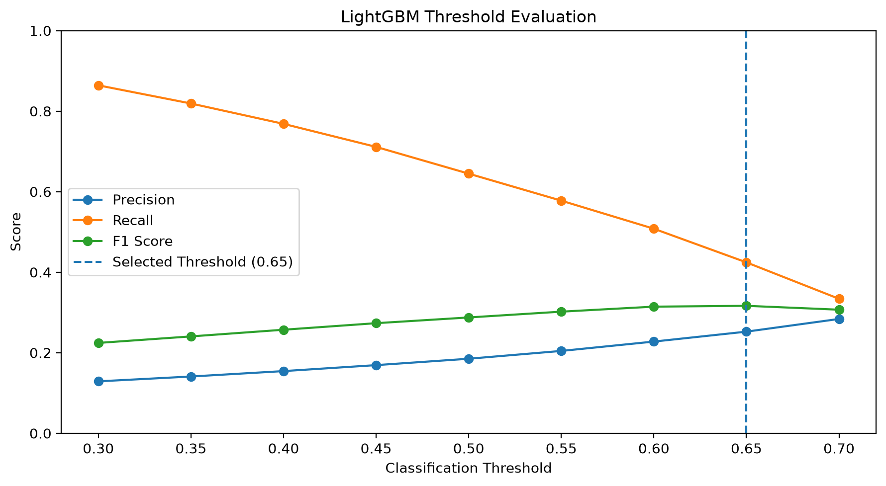
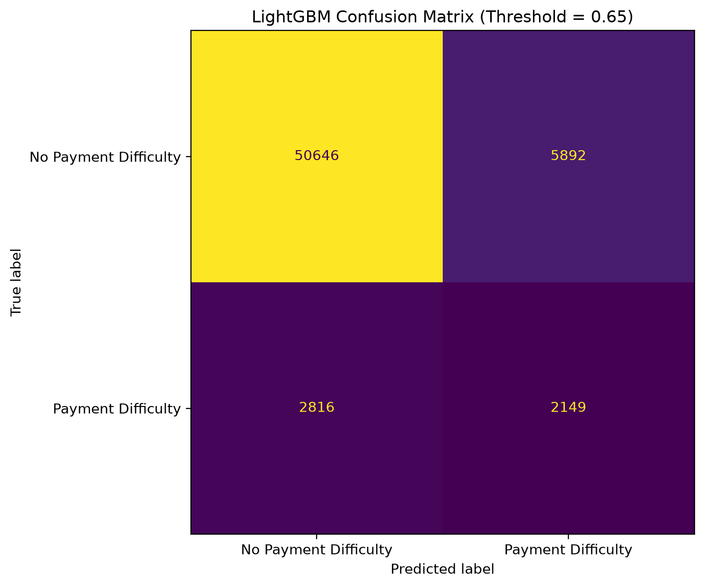
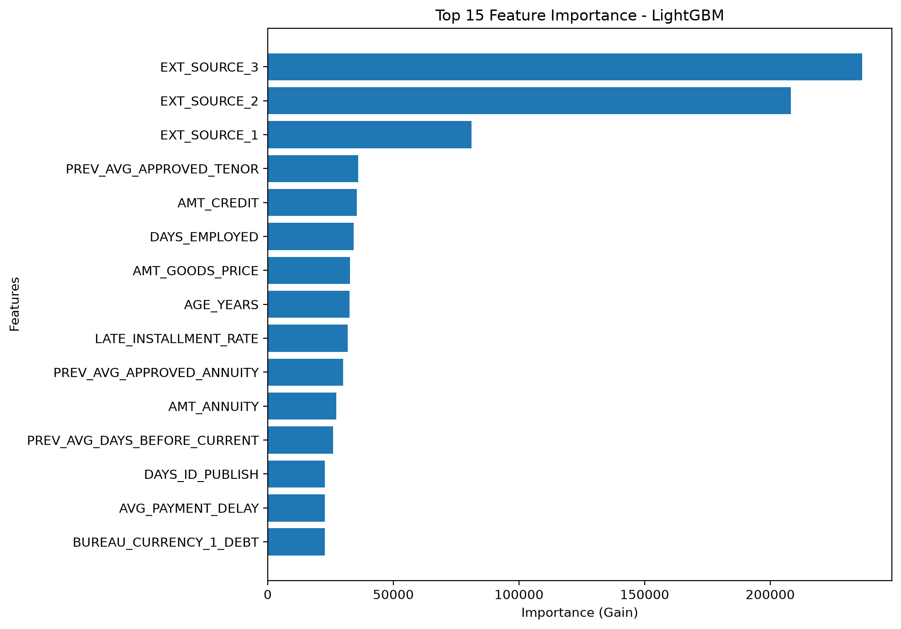
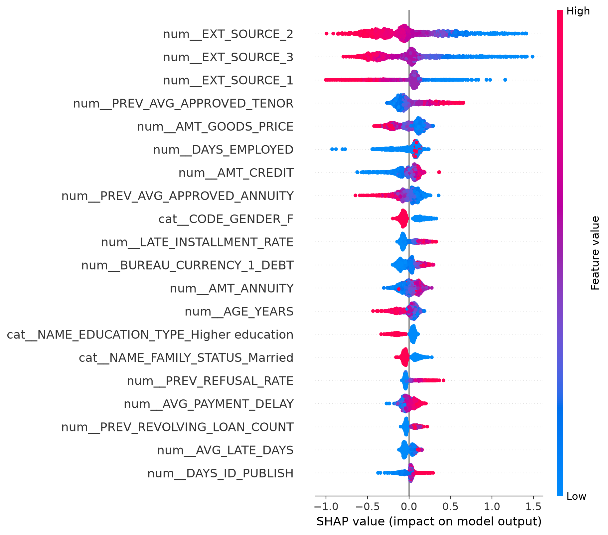
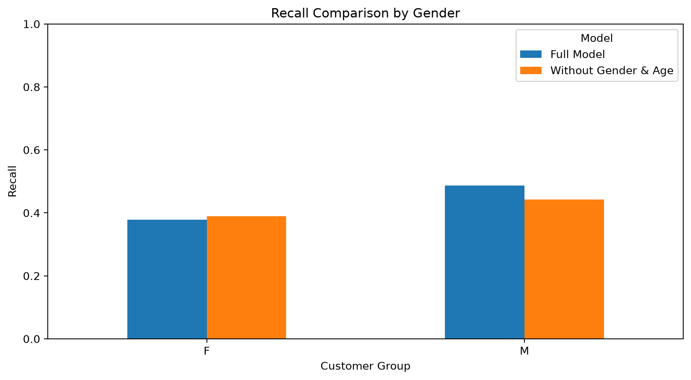
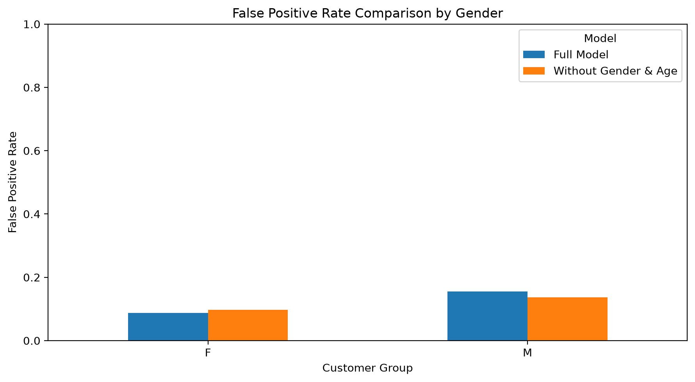
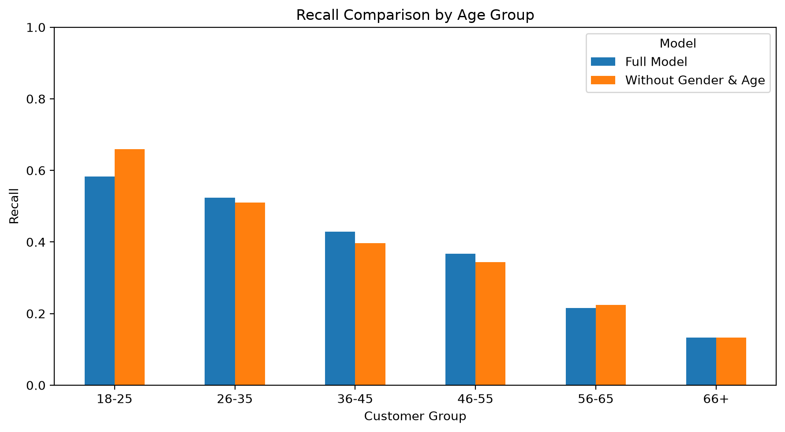
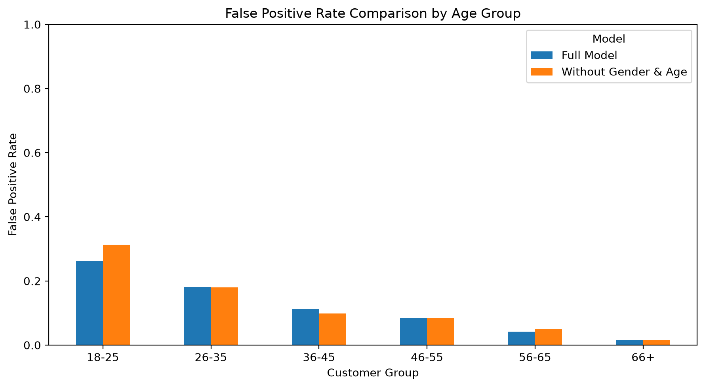

# Credit Risk Analytics & Prediction
### Machine Learning for Credit Risk Assessment

## Project Overview

Credit risk assessment is an important part of lending operations. Financial institutions need to understand an applicant's financial background and repayment behavior to identify potential payment difficulties.

This project explores how machine learning can support credit risk assessment by combining applicant information with historical credit records and installment payment behavior.

Using the Home Credit Default Risk dataset, the analysis integrates data from five sources to build a customer-level dataset. Three classification algorithms were developed and compared: Logistic Regression, Random Forest, and LightGBM.

LightGBM achieved the best initial performance, with a ROC-AUC of 0.7769 and PR-AUC of 0.2727. Further analysis focused on model interpretation using SHAP, classification threshold evaluation, and predictive performance across demographic groups.

**Project Objective:** Identify relevant credit risk indicators and develop a predictive model that can support application screening and risk assessment.

---

## Business Problem

Evaluating credit applications requires more than looking at an applicant's current financial information. Historical credit activities and repayment behavior can provide additional context about an applicant's ability to meet financial obligations.

This analysis addresses several business questions:

- Which applicant characteristics are associated with payment difficulties?
- How does historical repayment behavior contribute to credit risk identification?
- Which classification algorithm provides the strongest predictive performance?
- What factors have the greatest influence on credit risk predictions?
- Are there differences in model performance across demographic groups?

## Project Objectives

1. Examine applicant demographics, financial characteristics, and historical credit information.
2. Integrate multiple datasets into a customer-level analytical dataset.
3. Develop features representing previous credit activities and installment payment behavior.
4. Build and evaluate classification models for credit risk identification.
5. Interpret model predictions using feature importance and SHAP.
6. Assess model performance across gender and age groups.
7. Translate analytical findings into practical business recommendations.

---

## Dataset Overview

The analysis uses five related datasets from the Home Credit Default Risk data.

| Dataset | Records | Description |
|---|---:|---|
| `application_train.csv` | 307,511 | Applicant information, financial characteristics, and target labels. |
| `bureau.csv` | 1,716,428 | Historical credit records from other financial institutions. |
| `bureau_balance.csv` | 27,299,925 | Monthly credit status information. |
| `previous_application.csv` | 1,670,214 | Historical loan applications submitted to Home Credit. |
| `installments_payments.csv` | 13,605,401 | Historical installment schedules and actual payment transactions. |

### Target Variable

The target variable is `TARGET`, which indicates whether an applicant had payment difficulties.

| Target | Description |
|---|---|
| 0 | No recorded payment difficulties |
| 1 | Payment difficulties recorded |

The training dataset has an imbalanced target distribution, with approximately 92% of applicants in class 0 and 8% in class 1. This imbalance was considered during model development and evaluation.

---

## Methodology

The project follows an end-to-end analytical workflow, covering data preparation, exploratory data analysis, feature engineering, model development, evaluation, and business interpretation.

### 1. Data Preparation

The application training dataset was used as the primary customer-level dataset.

Historical information from bureau, bureau balance, previous applications, and installment payments was processed and aggregated using `SK_ID_CURR` as the customer identifier.

Key preparation steps included:

- Reviewing data types and missing values.
- Checking duplicate records and inconsistent values.
- Aggregating historical transactions at the customer level.
- Identifying applicants with and without historical credit information.
- Integrating the resulting features into the application dataset.

The integrated dataset contained **307,511 customer records and 202 columns**, including the customer identifier and target variable.

### 2. Feature Engineering

Historical records were transformed into customer-level features to capture different aspects of credit history and repayment behavior.

#### Bureau Features

Used to describe applicants' existing and previous credit obligations.

Key features included:

- Total previous credit accounts.
- Active, closed, sold, and bad-debt credit counts.
- Number of credits with overdue records.
- Maximum overdue days.
- Outstanding debt and overdue amount indicators.

#### Bureau Balance Features

Monthly credit status records were aggregated to capture historical repayment conditions.

Key features included:

- Number of credits with available monthly history.
- Number of credits with delinquency information.
- Total valid monthly records.
- Delinquent and severe delinquent months.
- Maximum observed delinquency status.
- Delinquency ratios.

#### Previous Application Features

Historical loan applications were aggregated to understand applicants' previous interactions with the lending institution.

Key features included:

- Total previous applications.
- Approved and refused application counts.
- Application approval and refusal rates.
- Average and median application amounts.
- Average approved credit amount.
- Average approved annuity and loan tenor.
- Time since the previous application decision.

#### Installment Payment Features

Installment payment records were processed to capture actual repayment behavior.

Since one installment could contain multiple payment transactions, records were consolidated using the following identifiers:

`SK_ID_CURR`, `SK_ID_PREV`, `NUM_INSTALMENT_VERSION`, and `NUM_INSTALMENT_NUMBER`.

This reduced the dataset from 13,605,401 payment records to **12,951,918 installment-level records**, with no duplicate installment identifiers remaining.

The following features were developed:

| Feature | Description |
|---|---|
| `INSTALLMENT_COUNT` | Total number of historical installments. |
| `FULLY_PAID_RATE` | Proportion of installments recorded as fully paid. |
| `LATE_INSTALLMENT_COUNT` | Number of installments paid late. |
| `LATE_INSTALLMENT_RATE` | Proportion of observed installments paid late. |
| `AVG_PAYMENT_DELAY` | Average payment delay relative to the due date. |
| `AVG_LATE_DAYS` | Average number of late days, with early and on-time payments counted as zero. |
| `MAX_LATE_DAYS` | Maximum observed payment delay. |
| `TOTAL_UNDERPAYMENT` | Total observed outstanding installment amounts. |
| `UNDERPAID_INSTALLMENT_COUNT` | Number of installments with recorded underpayment. |
| `UNDERPAID_INSTALLMENT_RATE` | Proportion of observed installments with underpayment. |

These features provide additional information about repayment consistency, payment delays, and incomplete payments.

### 3. Exploratory Data Analysis

Exploratory Data Analysis (EDA) was conducted to understand patterns in applicant characteristics, financial conditions, and historical credit behavior.

The analysis covered:

- Applicant age and employment characteristics.
- Income and credit amount distributions.
- Credit-to-income and annuity-to-income ratios.
- External assessment scores.
- Historical credit status and overdue patterns.
- Previous application approval and refusal patterns.
- Installment payment delays and underpayments.

The findings provided context for feature development and helped identify relevant indicators for credit risk modeling.

### 4. Data Preprocessing

The integrated dataset underwent preprocessing before model development.

| Feature Type | Preprocessing |
|---|---|
| Numerical | Median imputation |
| Numerical missing values | Missing-value indicators |
| Numerical scaling | StandardScaler |
| Categorical | Most-frequent imputation |
| Categorical encoding | One-Hot Encoding |

Selected features with extremely high missing-value rates, particularly rare bureau currency features, were excluded.

Additional history indicators were created to distinguish applicants without historical records from those with available credit or payment history.

After feature selection, the modeling dataset contained **188 input features**:

- 171 numerical features.
- 17 categorical features.

### 5. Train, Validation, and Test Split

The dataset was divided using stratified sampling to preserve the original target distribution.

| Dataset | Records | Proportion |
|---|---:|---:|
| Training | 184,506 | 60% |
| Validation | 61,502 | 20% |
| Testing | 61,503 | 20% |
| **Total** | **307,511** | **100%** |

Class imbalance was addressed through model-specific weighting strategies.

---

## Model Development

Three classification algorithms were developed and compared.

| Model | Approach | Purpose |
|---|---|---|
| Logistic Regression | Linear classification | Establish a baseline model. |
| Random Forest | Ensemble learning | Capture nonlinear relationships and feature interactions. |
| LightGBM | Gradient boosting | Capture complex patterns across applicant and historical credit features. |

### LightGBM Configuration

The selected LightGBM model used the following configuration:

| Parameter | Value |
|---|---:|
| Objective | Binary Classification |
| Number of Estimators | 500 |
| Learning Rate | 0.05 |
| Number of Leaves | 31 |
| Maximum Depth | -1 |
| Minimum Child Samples | 50 |
| Column Subsampling | 0.8 |
| Row Subsampling | 0.8 |
| L2 Regularization | 1.0 |
| Class Imbalance | `scale_pos_weight` |

The same core configuration was used for the full-feature and reduced-feature experiments.

---

## Model Evaluation

Model performance was evaluated using ROC-AUC, PR-AUC, precision, recall, F1-score, and confusion matrix.

These metrics provide a more comprehensive evaluation than accuracy alone, particularly because the target variable is highly imbalanced.

### 1. Initial Model Comparison

The initial model comparison produced the following results:

| Model | ROC-AUC | PR-AUC | F1-score (Class 1) |
|---|---:|---:|---:|
| Logistic Regression | 0.7665 | 0.2528 | 0.27 |
| Random Forest | 0.7513 | 0.2285 | 0.29 |
| **LightGBM** | **0.7769** | **0.2727** | **0.29** |

LightGBM achieved the highest ROC-AUC and PR-AUC among the evaluated models and was selected for further analysis.

**ROC-AUC Comparison**

**PR-AUC Comparison**

### 2. Classification Threshold Evaluation

The classification threshold was evaluated using the validation dataset to understand the trade-off between identifying applicants with payment difficulties and incorrectly flagging applicants without recorded payment difficulties.

A threshold of **0.65** achieved the highest F1-score among the evaluated thresholds.

The selected threshold produced the following validation results:

| Metric | Result |
|---|---:|
| Precision | 0.25 |
| Recall | 0.42 |
| F1-score | 0.32 |
| True Positive | 2,107 |
| False Positive | 6,242 |
| False Negative | 2,858 |

The threshold was selected based on F1-score rather than a monetary cost function. Therefore, it should be treated as an analytical operating point rather than a validated business decision threshold.

### 3. Final LightGBM Evaluation

The LightGBM model was retrained using the final training split. The threshold selected from validation was then applied to the test dataset.

**Test Set Performance**

| Metric | Result |
|---|---:|
| ROC-AUC | **0.7730** |
| PR-AUC | **0.2672** |
| Precision (Class 1) | 0.2673 |
| Recall (Class 1) | 0.4328 |
| F1-score (Class 1) | 0.3305 |
| Accuracy | 0.86 |

**Confusion Matrix**

| | Predicted: No Payment Difficulties | Predicted: Payment Difficulties |
|---|---:|---:|
| Actual: No Payment Difficulties | 50,646 | 5,892 |
| Actual: Payment Difficulties | 2,816 | 2,149 |

At the selected threshold, the model flagged **8,041 applicants** for further assessment and correctly identified **2,149 applicants** with recorded payment difficulties.

The results indicate that the model can help prioritize applications for additional review. However, its precision also means that predictions should be considered alongside other applicant information rather than used as automatic approval or rejection decisions.

---

## Model Interpretation

Model interpretability was examined using gain-based feature importance and SHAP to understand which applicant characteristics and historical credit behaviors contributed to model predictions.

### 1. Feature Importance

The feature importance analysis highlighted external assessment scores, previous credit characteristics, employment information, and installment payment behavior among the most influential model inputs.

Some of the leading features included:

| Feature | Business Context |
|---|---|
| `EXT_SOURCE_3` | External assessment information. |
| `EXT_SOURCE_2` | External assessment information. |
| `EXT_SOURCE_1` | External assessment information. |
| `PREV_AVG_APPROVED_TENOR` | Average tenor of previously approved loans. |
| `DAYS_EMPLOYED` | Employment history. |
| `AMT_CREDIT` | Requested credit amount. |
| `LATE_INSTALLMENT_RATE` | Historical proportion of late installments. |
| `AMT_ANNUITY` | Scheduled loan installment amount. |
| `AVG_PAYMENT_DELAY` | Average historical payment delay. |
| `PREV_REFUSAL_RATE` | Historical loan application refusal rate. |

### 2. SHAP Analysis

SHAP was used to examine how individual feature values influenced model predictions.

The main observations were:

- Lower external assessment scores generally contributed to higher predicted payment-difficulty risk.
- Higher late installment rates and payment delays generally pushed predictions toward the payment-difficulty class.
- Previous application characteristics, including refusal rates and approved loan tenor, contributed to the model's predictions.
- Financial variables such as credit amount, annuity, and goods price provided additional information for risk estimation.

These findings show that the model combines external assessment information, financial characteristics, and historical repayment behavior when identifying potential credit risk.

SHAP values describe model behavior and feature contributions. They should not be interpreted as causal relationships.

---

## Fairness Analysis

A preliminary fairness assessment was conducted to examine differences in model performance across gender and age groups.

Two model configurations were compared:

1. **Full Model:** Includes gender and age features.
2. **Reduced-Feature Model:** Excludes `CODE_GENDER`, `AGE_YEARS`, `AGE_GROUP`, and `DAYS_BIRTH`.

### 1. Overall Model Comparison

| Metric | Full Model | Reduced-Feature Model |
|---|---:|---:|
| ROC-AUC | 0.7697 | 0.7656 |
| PR-AUC | 0.2561 | 0.2497 |

Removing direct gender and age features resulted in a relatively small decrease in predictive performance.

### 2. Gender Analysis

| Group | Model | Recall | False Positive Rate |
|---|---|---:|---:|
| Female | Full Model | 0.38 | 0.09 |
| Female | Reduced-Feature Model | 0.39 | 0.10 |
| Male | Full Model | 0.49 | 0.16 |
| Male | Reduced-Feature Model | 0.44 | 0.14 |

The full model showed higher recall and a higher false positive rate for male applicants than for female applicants. Removing direct gender and age features changed these differences but did not eliminate them.

### 3. Age Group Analysis

| Age Group | Full Model Recall | Reduced-Feature Model Recall |
|---|---:|---:|
| 18–25 | 0.58 | 0.66 |
| 26–35 | 0.52 | 0.51 |
| 36–45 | 0.43 | 0.40 |
| 46–55 | 0.37 | 0.34 |
| 56–65 | 0.22 | 0.22 |
| 66+ | 0.13 | 0.13 |

Prediction performance varied across age groups. Recall was lower among older applicants, while younger groups showed higher false positive rates.

Removing direct gender and age features did not eliminate these differences, suggesting that other applicant characteristics may still contain correlated information.

This analysis represents an initial fairness assessment. It does not establish that the model is free from bias or fully compliant with lending regulations.

---

## Business Insights & Recommendations

The analytical findings provide several insights that can support credit risk assessment.

### Key Business Insights

**1. External Assessment Scores Are Important Risk Indicators**

The three external assessment features were among the most influential model inputs. Lower scores generally contributed to higher predicted payment-difficulty risk.

**2. Historical Payment Behavior Provides Additional Risk Information**

Late installment rates and average payment delays contributed to model predictions. This highlights the value of examining repayment behavior rather than relying exclusively on current application information.

**3. Previous Credit Applications Provide Additional Context**

Previous application characteristics, including refusal rates and approved loan tenor, helped the model distinguish between different applicant risk profiles.

**4. Financial Characteristics Contribute to Risk Assessment**

Credit amount, annuity, and goods price were also influential, supporting the importance of evaluating loan obligations alongside applicant financial information.

### Business Recommendations

| Area | Recommendation |
|---|---|
| Risk Screening | Use model scores to prioritize applications requiring additional review. |
| Payment Behavior | Examine recurring late payments and underpayment patterns as part of repayment assessment. |
| Repayment Capacity | Assess income, requested credit amount, and installment obligations together. |
| Historical Credit | Use previous application records as supporting information rather than treating previous refusals as automatic rejection criteria. |
| Model Governance | Monitor prediction quality and error rates across customer groups. |
| Human Review | Keep credit decisions subject to additional verification and human assessment. |

The model is intended to support risk identification and application prioritization, not to replace the complete credit assessment process.

---

